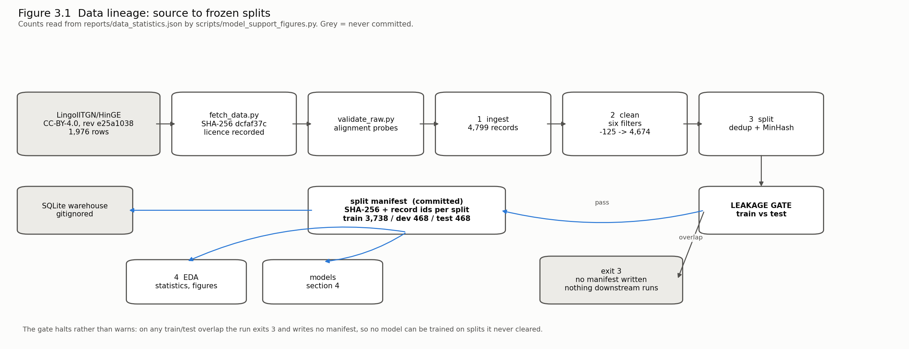

# 3.1 Data Process

Linear **298-57**. Written by Waghmare, Sarvesh.

This section describes how raw data reaches this project and how it becomes the training,
validation and test sets every model is measured on. Sections 3.3 to 3.5 describe what each
stage does to the records; this section is about the path itself, and about one property we
decided the path had to have: **a result must be reproducible from a clean clone by someone who
has never spoken to us.**

That constraint is why the process looks the way it does. No corpus file is committed, because
the corpora are licensed text and some of their licences do not permit redistribution. What is
committed instead is everything needed to fetch the same bytes and rebuild the same splits: the
pinned revision, the SHA-256 of each file, and a manifest recording the hash of every split.
The data is reproduced, not shipped.

## 3.1.1 The six steps

| # | Step | Tool | What it writes | Gate |
|---|---|---|---|---|
| 1 | Acquisition | `scripts/fetch_data.py` | `data/raw/<corpus>/`, `data/raw/MANIFEST.json` | Refuses a file whose SHA-256 does not match the recorded one; refuses a source with no stated licence |
| 2 | Validation | `scripts/validate_raw.py` | `reports/raw_validation.json`, `reports/raw_samples.md` | `--fail-on-misalignment` halts if the columns of a corpus do not describe the same sentence |
| 3 | Ingest | `scripts/run_pipeline.py` stage 1 | provenance record: row count, record count, input SHA-256 | Counts are measured, never asserted |
| 4 | Pre-process | stage 2, `src/lrcs/data/clean.py` | kept records, attrition table | Six filters, each removal charged to the first rule that rejects it (§3.3) |
| 5 | Split | stage 3, `src/lrcs/data/splits.py` | `data/processed/<corpus>/{train,dev,test}.tsv`, split manifest | **Leakage gate: exits 3 and writes no manifest if train and test overlap** |
| 6 | Describe | stage 4, `src/lrcs/analysis` | `reports/data_statistics.json`, figures 1–4 | — |

Steps 3 to 6 are one command:

```bash
python scripts/fetch_data.py --only hinge
cp data/raw/hinge/HinGE.csv data/raw/hinge.csv
python scripts/validate_raw.py --only hinge
python scripts/run_pipeline.py --input data/raw/hinge.csv --seed 42
```

## 3.1.2 Lineage



`reports/figures/fig3_1_lineage.png`, generated by `python scripts/model_support_figures.py`.
Its counts are read from `reports/data_statistics.json` rather than typed in, so the figure
cannot drift from the run it describes.

Figure 4.2.2 (`reports/figures/fig4_2_2_ml_dataflow.png`) carries the same lineage through to
scoring, including which artefacts are version-controlled.

## 3.1.3 Why the splits are frozen under a hash

A split file is not committed; its SHA-256 is. `data/processed/manifests/hinge_split_manifest.json`
records the input hash, every parameter that affects the outcome — seed 42, duplicate threshold
0.7, ratios 0.8/0.1/0.1, the MinHash settings, the cleaning thresholds — and for each split the
record count, the file hash and **the full list of record ids**.

That is a stronger guarantee than shipping the file. A file proves nothing about how it was
made: you cannot tell from `train.tsv` whether the leakage gate ran, what seed produced it, or
whether a row was edited afterwards. A manifest plus a deterministic pipeline proves both that
the recipe is deterministic and that the data in front of you is what the recipe produces.

The property has been exercised, not assumed. The committed manifest has been regenerated from
nothing but a clone and a download **four times on three machines**: twice locally, once inside
Google Colab on a Tesla T4, and once in continuous integration. Every run produced
`train 82c045f2…`, `dev db0b17cc…`, `test 6ac5d302…` and passed the leakage gate. The nightly
workflow (`.github/workflows/pipeline.yml`) makes the same comparison and **fails the build** if
it ever stops matching, because at that point every number measured on those splits is
unverified.

## 3.1.4 What is committed and what is not

| Committed | Not committed (gitignored) |
|---|---|
| Split manifests with SHA-256 and record ids | `data/raw/` — licensed sentences |
| `data/raw/MANIFEST.json`: URL, revision, bytes, hash, licence, citation | `data/processed/*.tsv` — the splits themselves |
| `reports/data_statistics.json` and the figures | `data/warehouse/lrcs.sqlite` — holds sentences |
| `runs/*.json`: seed, commit, GPU-hours per run | model weights and adapters |

## 3.1.5 Honest limits of the process

- **One corpus reaches the models.** Four are fetched and validated; only HinGE is split and
  trained on. The other three have defined roles (§3.2) and are not yet in the pipeline.
- **The pipeline is single-machine and single-threaded.** At 4,799 records that is irrelevant;
  at the scale PHINC would add, stage 3 is the part that would need attention — it is 88% of the
  9.4-second run.
- **`hi_roman` is a 30-line team fixture.** No corpus here has a Romanised-Hindi column, so the
  fertility slice requirement AI-6 names is met with a hand-built file. Dakshina would close it.

---

# 3.2 Data Collection

Linear **298-57**. Written by Waghmare, Sarvesh.

## 3.2.1 The four corpora

All four are fetched by `scripts/fetch_data.py` at a pinned revision and verified against a
recorded SHA-256. A source with no stated licence is refused by the script rather than argued
about later.

| Corpus | Source and revision | Licence | Bytes | Quantity | Role |
|---|---|---|---|---|---|
| **HinGE** | `LingoIITGN/HinGE` @ `e25a1038` | CC-BY-4.0 | 1,591,630 | 1,976 rows → **4,799** human references | **Primary.** The only corpus split and trained on. English / Devanagari Hindi / human Hinglish, which is the three-column structure the gold set and AI-6 both need |
| PHINC | `veezbo/phinc` @ `a50e9b69` | CC-BY-4.0 | 2,125,039 | 13,738 sentences | Scale. Reversed, it is English→Hinglish training data, and it is the official MixMT Subtask-2 training set |
| CMU Hinglish DoG | `festvox/cmu_hinglish_dog` @ `19796c6f` | CC-BY-SA-3.0 and GFDL | 1,039,828 | 9,962 pairs, splits fixed upstream at 8,060 / 942 / 960 | Baseline reproduction surface (§4.6). Replaces MixMT Subtask-1, whose test set was never released |
| Trilingual Hinglish | `debajyotimaz/trilingual-hinglish-corpus` @ `ea41ce29` | CC-BY-NC-SA-4.0 | 3,950,139 | 21,139 triples | Second three-column source. **Its Devanagari column is rejected — see §3.2.4** |

Total fetched: **8,706,636 bytes across 7 files.** Every row of that table is generated from
`data/raw/MANIFEST.json`, which the fetch writes; none of it is transcribed.

## 3.2.2 Why HinGE is the primary corpus

Three reasons, in order of weight.

1. **It has the Devanagari column.** Requirement AI-6 measures tokenizer fertility across four
   slices, one of which is Devanagari Hindi. Of the four corpora, only HinGE and Trilingual have
   that column, and Trilingual's is unusable (§3.2.4).
2. **Multiple human references per source.** 1,976 English sentences carry 4,799 human Hinglish
   references, a mean of 2.412 each. There is no single correct Hinglish translation of an
   English sentence, so §4.4's multi-reference scoring depends on having more than one.
3. **It is redistributable and verifiable.** CC-BY-4.0, published by the authors' own lab. An
   earlier version of `docs/datasheet.md` recorded the licence as "unstated, non-commercial
   (inferred)", and that error is why the corpus went unfetched for five weeks while the project
   ran on synthetic data. The correction is recorded in the carry-forward table.

## 3.2.3 Samples from the raw datasets

Verbatim records, truncated for the page. The full sample file is `reports/raw_samples.md`,
regenerated by `python scripts/validate_raw.py --samples`.

**HinGE** — English, Devanagari Hindi, human Hinglish:

| English | Hindi | Hinglish |
|---|---|---|
| It was presented to the Legislative Council in 1856 and was passed in 1860. | इसे 1856 में विधायी परिषद के समक्ष… | Ise 1856 me Legislative Council ke saamne rakha gaya… |
| Connecting to the server, please wait... | सर्वर से कनेक्ट कर रहा है, कृपया इंतजार… | Server se connect kar raha hai, kripya wait… |

**PHINC** — no Devanagari column; social-media register, handles preserved:

| English | Hinglish |
|---|---|
| @some users congratulate you for celebrating British kid singers… | @someUSER congratulations… |

The register difference is the point of holding both: HinGE is written, formal, often
administrative; PHINC is conversational. A model trained only on HinGE will be measured on
HinGE, and §4.3 says so.

## 3.2.4 A corpus we rejected, and the evidence

Three eyeballed rows of the Trilingual corpus looked misaligned — the Hindi column did not
appear to describe the English one. **A first digit-agreement test did not support that
suspicion** (0.796 against HinGE's 0.790), so it was measured properly instead of asserted.

`scripts/validate_raw.py` probes alignment with signals that survive translation: digit runs,
`@handles` and `#hashtags`, and length correlation. The decisive one is an inverse test — tags
present in the Hindi column that the English column never had. **A translation can drop a
handle; it cannot invent one.**

| Corpus | English↔Hinglish corr. | English↔Hindi corr. | Invented-tag rate |
|---|---:|---:|---:|
| HinGE | +0.952 | +0.943 | **0.1%** |
| Trilingual | +0.896 | +0.783 | **15.8%** |

One row in six of Trilingual's Hindi column came from a different source sentence. Its
`english`→`hinglish` pair is sound and remains available; its Devanagari column is not used, and
the Devanagari slice comes from HinGE. The check runs before anything is built on a corpus, so
this cost nothing downstream.

## 3.2.5 Is this sufficient?

For the 298A scope, yes, with one qualification. 4,799 supervised pairs is small for
fine-tuning, and it is enough: M2 reached chrF++ 51.683 ± 1.154 against M1's 40.666 on three
seeds (§4.5), with non-overlapping intervals. The qualification is that **every result in this
report is measured on one corpus of one register**, and the 24,000 further pairs in PHINC and
Trilingual are fetched and validated but not yet used. Bringing them in is M4's augmentation
work in 298B, and until then the generalisation claim is limited to HinGE-like text.

## 3.2.6 Coverage gap

HinGE's English side is largely administrative and encyclopaedic prose — legislative text,
software strings, government descriptions. It under-represents the conversational register in
which Hinglish is most used. A system trained on it and deployed on chat or social text would
be weakest exactly where real code-switching is densest, which disadvantages ordinary speakers
relative to institutional users. PHINC is the corpus that would close this, and §3.6 records
the gap with the same conclusion.
