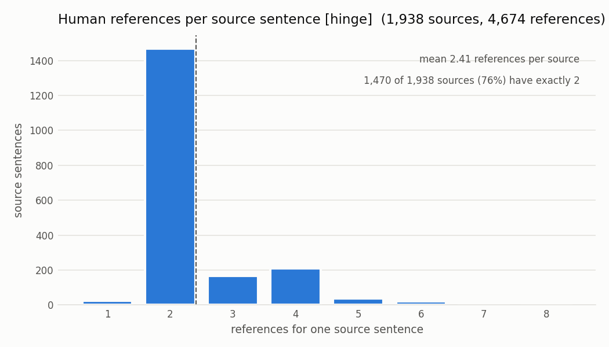
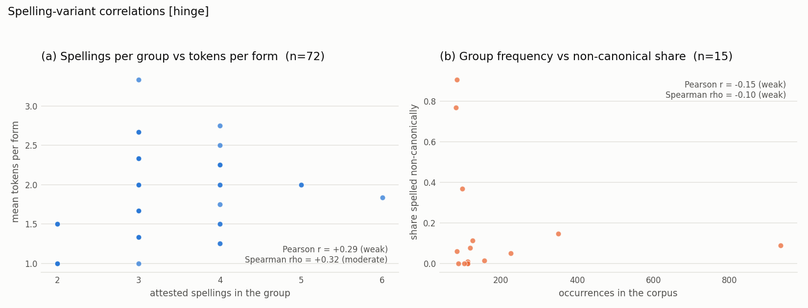

# 3.6 Data Statistics

Linear **298-65**. Written by Waghmare, Sarvesh.

Every corpus figure in this section is read from a committed artifact of the 8 October
run on the real HinGE corpus — `reports/data_statistics.json` and
`reports/fertility.variants.csv` — and every plot is regenerable from a clean clone.
The one exception is tokenizer fertility, which has so far been measured only on
synthetic slices and is labelled as such where it appears. Nothing here is typed in by hand.

## 3.6.1 What each stage produced

| Stage | Rows | Columns | Notes |
|---|---|---|---|
| Raw | 1,976 file rows → **4,799** records | 6 | one record per *reference*, not per sentence: `id, english, hindi, hinglish, row, ref` |
| Pre-processed | **4,674** | 7 | adds `tags`, the per-token language label; 125 records removed by six filters |
| Transformed | **4,674** | 5 | the split TSV layout: `id, group, english, hindi, hinglish` |
| Prepared | **3,738 / 468 / 468** | 5 | train / validation / test, frozen under SHA-256 |

The row counts come from the committed run. The column counts are the fields a
record carries at that stage, which is the meaningful width once stage 1 has
expanded one source row into several records; after that point the source file's
own width no longer describes the data. The pipeline now records this table
directly (`stages` in `data_statistics.json`), so the next real-corpus run fills
it without anyone transcribing it, including the released file's own column
count, which the 8 October run did not retain.

The single most misread number here is the first one. **1,976 is sentences;
4,799 is references.** HinGE gives multiple human Hinglish renderings of the same
English sentence, so the corpus is roughly 2.4 times larger in records than in
distinct source material. A reader who takes 4,799 as the amount of independent
data will overestimate it by that factor.

Attrition is small and accounted for: 125 of 4,799 records removed, 2.6%, with
every removal charged to the first filter that rejected it so the six rows sum to
the total rather than double-counting. Section 3.3 carries the per-filter table.

The whole pipeline runs in 11.96 seconds — ingest 0.23 s, clean 0.54 s, split
9.16 s, statistics and figures 2.02 s. The split stage dominates because it is
the only quadratic-ish step: MinHash signatures over 1,938 sources, banded into
candidate pairs.

## 3.6.2 Distributions

Four distribution figures are committed:

| Figure | File | What it shows |
|---|---|---|
| 1 | `reports/figures/fig1_sentence_lengths.png` | sentence length, English against Hinglish |
| 2 | `reports/figures/fig2_cmi_distribution.png` | Code-Mixing Index per sentence |
| 3 | `reports/figures/fig3_switch_point_fraction.png` | switch-point fraction per sentence |
| 4 | `reports/figures/fig4_spelling_variants.png` | spelling variants per lexicon group |

**Length.** English averages 15.24 words (median 12, p95 37, range 3–60);
Hinglish averages 15.87 (median 12, p95 39, range 2–60). The mean
Hinglish-to-English word ratio is 1.062. Code-switching is close to
length-neutral here, which matters because the `length_ratio` filter would
otherwise be removing signal rather than noise.

**Vocabulary.** English contributes 6,780 types over 71,217 tokens; Hinglish
contributes **13,204 types over 74,165 tokens** — nearly double the vocabulary for
the same quantity of text, at a type-token ratio of 0.178. That is the
orthographic-variance problem stated in plain counts. The tokenizer measurement points
the same way, with fertility of 1.653 on Hinglish against 1.154 on English, but those
slices are synthetic (`reports/fertility_ai6.md`) and are illustrative until re-measured
on HinGE. The coverage contrast once quoted alongside them, 98.5% against 52.6%, did not
survive re-measurement and is withdrawn (carry-forward table).

**Code-mixing.** Mean CMI is 25.34 across all sentences and 29.42 across the
mixed ones; 86.1% of sentences are mixed. Switch-point fraction is 0.240 overall
and 0.272 per sentence, over 10,861 switch points, with a mean monolingual span
of 3.22 tokens. The M-index is 0.693 and burstiness 0.056, so switching is close
to evenly spaced rather than clustered.

These rest on a tagger covering **68.2%** of tokens. That limitation belongs with
the number every time it is quoted, and it reappears in 3.6.4.

## 3.6.3 Imbalance

`reports/figures/fig5_references_per_source.png`

The corpus's main imbalance is not class imbalance — the task has no classes —
but **how unevenly supervision is distributed across source sentences**. After
cleaning, 1,938 distinct sources carry 4,674 references, a mean of 2.41 each,
distributed as:

| References for one source | 1 | 2 | 3 | 4 | 5 | 6 | 7 | 8 |
|---|---|---|---|---|---|---|---|---|
| Source sentences | 26 | 1,470 | 166 | 210 | 37 | 21 | 5 | 3 |

**76% of sources have exactly two references**, and a 14% tail has four or more.
Three consequences for training:

1. A source with eight references appears eight times in an epoch and one with a
   single reference appears once, so the long tail is up-weighted by a factor of
   eight purely as an artifact of how the corpus was collected.
2. Because splits are assigned by whole near-duplicate group (section 3.5), a
   heavily-referenced source lands entirely in one split, which makes split
   record counts lumpier than source counts — the reason the splits land at
   79.97 / 10.01 / 10.01 rather than exactly 80/10/10.
3. Multiple valid references for one input are a *property of the task*, not
   noise. Single-reference chrF++ systematically understates a model that
   produces a legitimate rendering the reference did not happen to use. This is
   an argument for reporting against all available references where the metric
   allows it, and it is a known limitation of the interim HinGE-test scoring
   until the team-authored set exists.

A second imbalance sits in the lexicon: of 72 spelling-variant groups, 68 are
observed and only **28 carry two or more distinct spellings**, with 13% of their
3,812 occurrences spelled non-canonically. The burden metric of 1.832 is
therefore driven by a minority of groups, which is exactly the condition under
which vocabulary extension could buy less than expected — recorded in section 4.3
as a stated way the preferred model loses.

## 3.6.4 Correlation

`reports/figures/fig6_variant_correlations.png`. Measured values are written to
`reports/workbook2_figures.json` by `scripts/workbook2_figures.py`.

Two relationships the hypothesis predicts were tested. **Both are reported as
measured.**

**(a) Do words with more attested spellings cost more tokens per form?**
Over all 72 lexicon groups: Pearson **r = +0.29**, Spearman **ρ = +0.32**. The
direction matches the hypothesis and the strength is weak-to-moderate — real, but
far from deterministic. Spearman exceeding Pearson indicates the relationship is
monotonic rather than linear, which is what a subword tokenizer should produce:
each additional spelling tends to add a split, but the increments are not equal.

This is the quantitative core of the project's claim, and it is honest to say the
relationship is *present and modest* rather than strong. A group can have six
spellings and still average 1.83 tokens if the backbone happens to carry most of
them, and `nahi` is exactly that case.

**(b) Are commoner words spelled more inconsistently?**
Over the 15 most frequent groups: Pearson **r = −0.15**, Spearman **ρ = −0.10**.
**This is a null result**, and it is informative. Frequency does not protect a
word from spelling variance, nor drive it. Variance appears to be a property of
the word's phonology and transliteration ambiguity rather than of how often it is
written — `hai` occurs 934 times and is spelled non-canonically 8.8% of the time,
while rarer groups in the same panel reach 77% and 91%.

The caveat is n: panel (b) rests on the 15 groups retained in
`spelling_variance.top_groups`, which is too few to exclude a weak effect. The
full-lexicon version is cheap to compute on the next pipeline run and should be
recomputed before this result is relied on. Panel (a), at n = 72, is the whole
lexicon and needs no such caveat.

Neither correlation was selected after looking at several; both were named before
being computed, and the null result is reported with the same prominence as the
positive one.

## 3.6.5 Coverage gaps, and who they disadvantage

The data is not representative of the population a deployed system would meet.
Five gaps, each with the group it would fail.

**Language pair.** HinGE is Hindi–English only. The identical problem exists for
Tamil, Bengali, Marathi, Telugu and Punjabi code-switching, and nothing here
transfers automatically. *Disadvantaged: speakers of every Indian language other
than Hindi* — the majority of India's multilingual internet users — who would see
a system marketed as serving code-switched input fail on theirs.

**Tagger coverage.** The language tagger resolves 68.2% of tokens; **19,382 of
83,922** are `unk`. Unresolved tokens are disproportionately the rare and
unusually-spelled ones, so **the measurement is weakest exactly where the
hypothesis is strongest**. *Disadvantaged: anyone whose spelling is already
atypical* — regional spellers and younger informal writers — whose text is both
least well measured and least well modelled, and who would therefore not appear
in any error analysis built on these tags.

**Register.** HinGE's English sources come from a formal, literary parallel
corpus. Conversational Hinglish — abbreviations, repeated characters, emoji-
adjacent spellings, sentence-initial Roman Hindi — is essentially absent, though
it is where Hinglish overwhelmingly occurs. *Disadvantaged: ordinary users in
chat and social contexts*, the actual deployment setting, who would get a system
tuned to a register they do not write in.

**Monolingual inputs.** 86.1% of sentences are code-mixed, so monolingual Hindi
and monolingual English are under-represented. *Disadvantaged: users who switch
in and out of code-mixing* — most bilinguals — on their monolingual turns, which
is the simplest case and the least tested.

**Demographics.** No speaker metadata is recorded: no region, age, gender or
first language. Representation therefore **cannot be checked at all**, only
assumed. *Disadvantaged: any group whose transliteration conventions differ from
the annotators'* — Mumbai, Bihar and the South romanise differently — with no way
to detect the gap before deployment, because the information needed to measure it
was never collected.

The last gap is the most serious, because it is the only one that cannot be fixed
by adding data later. The team-authored 800-item evaluation set (298-55) is the
one place where this is still in our control, and the annotation guidelines
should record annotator region and first language even though HinGE did not.

## Provenance

| Claim | Source |
|---|---|
| stage rows, attrition, splits, timings | `reports/data_statistics.json` |
| lengths, vocabulary, code-mixing, spelling variance | same |
| fertility (synthetic slices), burden | `reports/fertility.csv`, `reports/fertility_ai6.md` |
| per-group variant counts | `reports/fertility.variants.csv` |
| imbalance and correlation figures | `scripts/workbook2_figures.py` |
| measured correlation coefficients | `reports/workbook2_figures.json` |
| stage samples | `reports/samples/<corpus>/` (298-62) |
