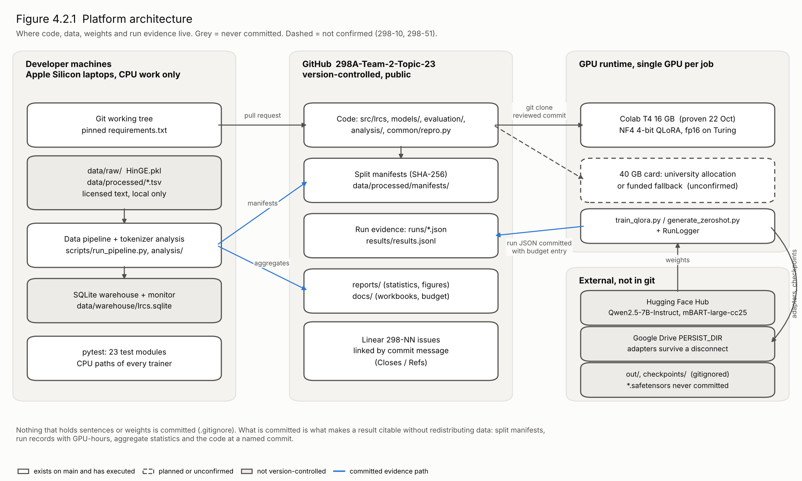
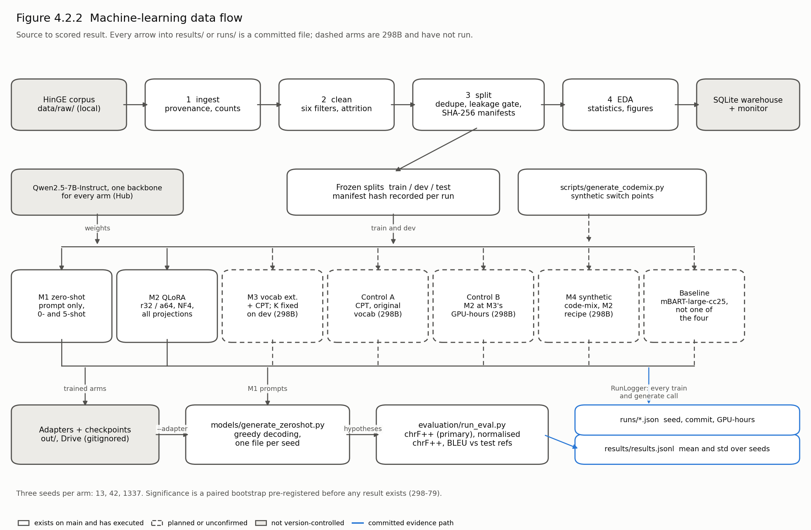
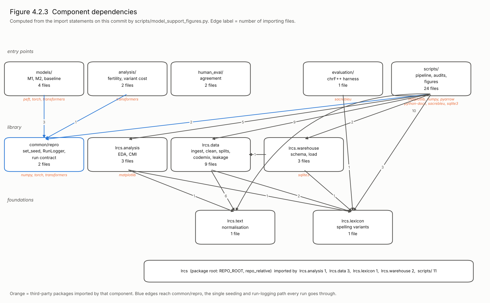

# 4.2 Model Supports

Linear **298-67**. Written by Singh, Prakhar Kumar.

This section describes the platform, environment and tools that support developing and running
each model proposed in section 4.1, and gives three diagrams of it: the platform architecture,
the machine-learning data flow and the component dependencies. Each diagram is generated by a
committed script, `scripts/model_support_figures.py`, for the same reason the Gantt and PERT charts
are: a figure nobody can regenerate cannot be checked against the repository it claims to describe.

Two facts govern the rest of the section. **No departmental GPU allocation is confirmed** — the
request raised on 26 September (298-10) and its follow-up (298-51) are both open. **It has stopped
being a blocker.** On 11 November Models 1 and 2 were trained and scored on a hosted Colab A100
(40 GB): the §4.1 recipe as written, NF4 with double quantisation, three seeds, 1.508 GPU-hours,
on the real HinGE splits. `docs/COMPUTE_BUDGET.md` records 3.039 GPU-hours in total, of which
0.199 are smoke tests and 2.840 are real work. Everything below separates what has executed from
what is planned, and the diagrams draw the two differently; the diagrams were generated before the
A100 run and still show the T4 as the only proven runtime, which `scripts/model_support_figures.py`
will correct on its next run.

## 4.2.1 Shared environment

Every model runs from one pinned environment and one reproducibility path, so that a difference
between two arms can only come from the arm.

| Layer | What we use | Pinned in | Why it is pinned or chosen |
|---|---|---|---|
| Language runtime | Python 3.11 or 3.12 for GPU jobs; one developer machine is on 3.9 | `requirements.txt` | `matplotlib==3.9.4` and `pyarrow==21.0.0` are held at the last lines that still support the one team machine on Python 3.9 |
| Deep learning | `torch==2.6.0`, `transformers==4.57.6`, `tokenizers==0.22.2`, `accelerate==1.10.1` | `requirements.txt` | `transformers` is held on the last 4.x release. Unpinned, it resolved to 5.x in Colab and broke `TrainingArguments`; 4.57.6 still satisfies Qwen's minimum of 4.51 |
| Parameter-efficient training | `peft==0.17.1`, `bitsandbytes==0.47.0` | `requirements.txt` | 4-bit NF4 quantisation with double quantisation, the QLoRA recipe of Dettmers et al. (2023) on LoRA adapters (Hu et al., 2022) |
| Tokenization | `sentencepiece==0.2.0` | `requirements.txt` | M3's vocabulary construction and the tokenizer fertility measurement |
| Evaluation | `sacrebleu==2.6.0` | `requirements.txt` | chrF++ (Popović, 2017), the primary metric, and BLEU, scored by `evaluation/run_eval.py` |
| Data and storage | Python's `sqlite3`, `pyarrow` | standard library, `requirements.txt` | The pipeline warehouse (`data/warehouse/lrcs.sqlite`, gitignored) and Samanantar's parquet shards |
| Reproducibility | `common/repro.py`: `set_seed` and `RunLogger` | repository | One seeding function for every source of randomness, and one JSON record per run with its seed, commit and GPU-hours under `runs/` |
| Testing | `pytest` | `tests/` | 27 test modules; **301 tests pass and 4 skip** on this branch with 298-53 and 298-54 merged. The CPU paths of every trainer are covered, including argument handling, prompt assembly and completion-only label masking in `tests/test_train_qlora.py` |
| Version control and tracking | GitHub, Linear | repository, board | Every commit names its issue with `Closes 298-NN` or `Refs 298-NN` |

The backbone for every arm except the baseline is `Qwen/Qwen2.5-7B-Instruct`, adopted in section
1.4: 7.62B parameters, a 152,064-token vocabulary, 15.2 GB in bf16 and about 3.8 GB at 4 bits. One
backbone across arms is requirement AI-9. The baseline uses `facebook/mbart-large-cc25`, the
checkpoint `models/train_mbart_baseline.py` takes from Gahoi et al. (2022). Weights are downloaded
from the Hugging Face Hub at run time and are never committed.

### Hardware

| Tier | Hardware | State | Used for |
|---|---|---|---|
| Developer machines | Apple Silicon laptops, CPU only | In use | The data pipeline, tokenizer analysis, warehouse, all tests and all figures. `bitsandbytes` 4-bit kernels need CUDA, so the quantised path cannot be tested here |
| Colab T4 | NVIDIA T4, 16 GB, Turing | **Proven 22 October** on the smoke run, and again 11 November | Proved the CUDA path end to end, including NF4 quantisation and adapter reload. 0.199 GPU-hours across both smoke sessions |
| Colab A100 | NVIDIA A100-SXM4, 40 GB, Ampere | **Proven 11 November** on the reportable run | Models 1 and 2, real corpus, real 7B backbone, three seeds, NF4 double quantisation, native bf16. 1.508 GPU-hours, twelve run records under `runs/`. This is where the reported M1/M2 numbers come from |
| 40 GB allocation | At least one 40 GB card, three independent single-GPU slots | **Unconfirmed** (298-10, 298-51) | The reportable runs for every trained arm |
| Fallback | Colab Pro+ or a quoted single-GPU cloud instance | **Not funded** | The same, if the allocation is refused. `docs/COMPUTE_ALLOCATION.md` gives the runbook, which has not yet been executed |

The T4 run found one platform defect worth recording. `torch.cuda.is_bf16_supported()` counts
emulated support by default and answered True on a T4, which has no bf16 hardware, so thirty steps
of a 0.5B model took 301 seconds through a software path. `models/train_qlora.py` now asks for
native support only and falls back to fp16 on pre-Ampere cards. A future T4 run record that still
reads `bf16` means the fix has regressed.

## 4.2.2 Support required by each model

The models differ in what they update (section 4.1), so they differ in what they need. Memory
figures marked *our arithmetic* are estimates, not measurements; no 7B job has run yet.

| Model | Entry point | GPU need | Peak memory, main contributor | Other support | State on `main` |
|---|---|---|---|---|---|
| M1 zero-shot | `models/generate_zeroshot.py` | Inference only; any CUDA GPU | About 15 GB for the bf16 backbone *(our arithmetic)* | Greedy decoding; 0- and 5-shot prompts | **Complete (298-53).** Three seeds on the adopted backbone, 0- and 5-shot, 197 test sources: chrF++ 40.666 0-shot against 38.474 5-shot, so few-shot measurably hurts. 0-shot shows zero seed variance because decoding is greedy. The script's default model is still `Qwen/Qwen3-8B` and must be overridden, which `README.md` records as a known gap |
| M2 QLoRA | `models/train_qlora.py` | One GPU; a 16 GB T4 suffices for one seed, slowly | About 3.8 GB of 4-bit weights plus adapters and activations; gradient checkpointing on | Rank 32, alpha 64, all seven linear projections, effective batch 32, loss on the completion only | **Complete (298-54).** Three seeds on an A100, 3 epochs, 351 steps each, 80,740,352 trainable parameters: **1.277 GPU-hours of training, 1.508 including inference.** The earlier extrapolation of 4–6 GPU-hours on an A100 was roughly four times the measured cost, which matters for the 298-72 reservations. chrF++ 51.683 ± 1.154 against M1's 40.666 |
| M3 vocabulary extension + CPT | Not yet written | One 40 GB GPU. The embedding and LM head cannot stay 4-bit while they train | Stage 1 trains both 545.0M-parameter matrices; at 16 bytes per trained parameter for weights, gradients and Adam state that is **17.4 GB** before activations *(our arithmetic)*. It does not fit a 16 GB T4 and is marginal on 24 GB | SentencePiece diff on the train split; K chosen on the dev split at the tokenizer level, on CPU, before any GPU time (section 4.1) | Not started (298B) |
| Control A | As M3, original tokenizer | As M3 | As M3 | Identical stages and data to M3 | Not started (298B) |
| Control B | `models/train_qlora.py`, resumed from each M2 seed | As M2 | As M2 | Each M2 seed continues until it has used M3's GPU-hours (298-72). The trainer has no resume-from-adapter option yet; adding one is part of this arm | Not started (298B) |
| M4 synthetic augmentation | `scripts/generate_codemix.py`, then the M2 trainer | As M2, plus a reverse Hinglish-to-English model for back-translation | As M2 | Synthesis runs on CPU; only the reverse model and the fine-tune need a GPU | Synthesis run on a 30,000-pair real slice (298-76); training not started |
| Baseline, not one of the four | `models/train_mbart_baseline.py` | One GPU; full fine-tune of 610M parameters | About 9.8 GB of weights, gradients and Adam state *(our arithmetic)* | 10,000 steps fixed by the paper; both input conditions | Trainer merged with tests; not run (298-52) |

If only 24 GB cards are offered, M3 and Control A are the arms at risk. The plan, recorded in
Workbook 1 section 2.3 and `docs/COMPUTE_ALLOCATION.md`, is to profile M3's peak memory with
gradient checkpointing and a smaller batch before scheduling it, and, if it still does not fit, to
agree one smaller common backbone for every compared arm **before** any result exists, so that the
comparison stays like for like.

## 4.2.3 Platform architecture



`reports/figures/fig4_2_1_platform.png`

Figure 4.2.1 shows four places a file can live. Developer machines hold the working tree and the
licensed corpus, which is read locally and never leaves them: `data/raw/` and `data/processed/` are
gitignored, as is the SQLite warehouse, because each contains sentences. GitHub holds the code and
everything that makes a result citable without redistributing the data: the SHA-256 split
manifests, the run records, the aggregate statistics and the documents. The GPU runtime clones a
reviewed commit, downloads the backbone from the Hub, and writes adapters and checkpoints to `out/`
or to a mounted Google Drive folder so that a dropped Colab session does not lose finished seeds.
Neither location is committed. What returns to the repository is the run record, committed in the
same change as the budget entry it updates.

The one dashed component is the 40 GB allocation. It is drawn because the plan depends on it and
drawn dashed because it does not yet exist.

## 4.2.4 Machine-learning data flow



`reports/figures/fig4_2_2_ml_dataflow.png`

Figure 4.2.2 follows one sentence from source to score. The pipeline's four stages
(`scripts/run_pipeline.py`) ingest HinGE with its provenance, clean it through six filters, split it
with deduplication and a leakage gate, and compute the statistics of section 3.6. Stage 3 freezes
the splits: 3,738 train, 468 dev and 468 test records (`reports/data_statistics.json`), each split
identified by the hash in its manifest. Every arm reads the same frozen splits and the same
backbone, which is what lets section 4.4 compare them.

The arms divide at one point. M1 sends prompts straight to generation. Every trained arm writes
adapters, which `models/generate_zeroshot.py` loads with `--adapter`. Generation writes one
hypothesis file per seed; `evaluation/run_eval.py` scores it against the test references and
appends the mean and standard deviation over seeds to `results/results.jsonl`. Separately, every
training and generation call runs inside `RunLogger`, which writes the record under `runs/` that
the GPU-hour budget is reconciled against. The two blue outputs are the only places a number in
the results table may come from.

## 4.2.5 Components



`reports/figures/fig4_2_3_components.png`

Figure 4.2.3 is not drawn by hand. The script parses every Python file under `src/lrcs`, `common`,
`models`, `evaluation`, `analysis`, `human_eval` and `scripts`, resolves each import to a
component, and draws the edges it finds with the number of importing files on each. The edge list
is also written to `reports/figures/fig4_2_3_components.json`, so the figure can be checked without
reading pixels.

The library has three layers. `lrcs.text` (normalisation) and `lrcs.lexicon` (the spelling-variant
groups) are the foundations; `lrcs.data`, `lrcs.analysis` and `lrcs.warehouse` build on them; the
entry points in `scripts/`, `models/`, `evaluation/` and `analysis/` sit on top. The only
dependency inside the middle layer is the warehouse reading the split definitions from `lrcs.data`.

Generating the figure from code surfaced three facts the written plan did not state:

- **`models/` does not import `lrcs` at all.** The trainers read the split TSVs column by column
  and apply no normalisation of their own, so the text a model trains on is exactly what stage 3
  wrote. Any normalisation change therefore reaches the models only through a new split, with a
  new manifest hash.
- **`evaluation/` imports `lrcs.lexicon` but not `common/repro`.** Normalised chrF++ maps spelling
  variants through the shared lexicon, which is correct. Scoring writes `results/results.jsonl`
  but no run record. Scoring is CPU work and costs no GPU-hours, so the budget is unaffected, but
  the results row and the run record are linked only through the hypothesis file. 298-73 closes
  that by recording the commit, seed and split hash in one run contract that the results table is
  generated from.
- **`human_eval/` has no internal dependencies.** The agreement tooling imports nothing from the
  library, so a change to normalisation cannot alter an agreement score.

## 4.2.6 Compute budget

Workbook 1 section 2.3 committed to a 130 GPU-hour target and a 145-hour hard cap. The per-arm
estimates in `docs/COMPUTE_BUDGET.md` summed to 177. 298-72 resolves the conflict in two parts,
proposed by Singh on 11 November for sign-off at Team Meeting 2 on 12 November:

1. **Two arms shrink, losing little.** M3 trains one vocabulary size on the GPU instead of
   several, because the K sweep runs at the tokenizer level on CPU (section 4.1): 45 to 36
   GPU-hours. Control B resumes each M2 seed for M3's hours minus M2's instead of retraining from
   the start: 25 to 11. The cost of the second change is that Control B's learning-rate schedule
   becomes two segments rather than one longer run, which the results section will state.
2. **The cap is made explicit.** The abstract's 145 hours becomes the training cap, and inference
   and evaluation are budgeted separately at 20, as `docs/COMPUTE_BUDGET.md` has carried since
   298-26. The hard cap is **165 GPU-hours**; the plan totals **154**, leaving 11 in reserve. At
   the $2 per GPU-hour planning assumption the cap costs $330 against $290 before.

`docs/COMPUTE_BUDGET.md` holds the arithmetic and the sign-off, and the carry-forward table
records the change to section 2.3. One risk is carried with it: Control A runs the same two stages
as M3 but is budgeted at 20 hours against M3's 36, and if it has to match M3's steps the plan
exceeds the reserve. The first measured M3 seed settles that, before Control A is scheduled.

## 4.2.7 Regenerating this section's evidence

```bash
python scripts/model_support_figures.py --check     # the three figures and the edge list
python -m pytest -q                                 # 301 pass, 4 skip on this branch
python common/repro.py --summary runs/              # GPU-hours spent against the cap
```

`--check` fails if a component appears in the repository that the diagram has no place for, so the
figure cannot silently fall behind the code.
